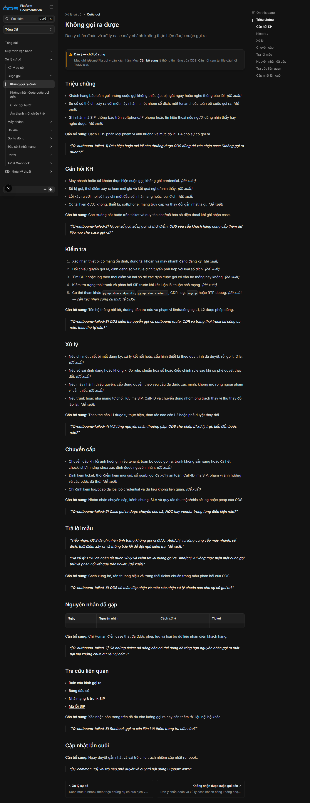

# TASK-018 — Báo cáo dàn ý Support Wiki `/internal`

## Trạng thái

- Branch: `task/TASK-018-internal-outline`
- Base: `4193b71` — merge commit TASK-014 trên `origin/main`.
- Task status: `in-progress`.
- Không sửa source code, harness, metadata điều hướng hoặc vùng public.
- Không push branch hoặc mở Pull Request.

## Lô 0 — Task và câu hỏi chung

- Tạo task spec TASK-018 với phạm vi đã duyệt.
- Chuyển TASK-014 sang `done`, commit `4193b71` theo xác nhận merge của Human.
- Tạo 11 câu hỏi chung về mức độ, SLA, ca trực, ticket, vai trò chuyển cấp, nền tảng và công cụ debug.
- Commit: `fc86f6c docs(task-018): add outline plan and close task 014`.
- `npm run verify:task`: PASS — 233/233 static pages, 12/12 route tests.
- `npm run check:links`, `npm run check:scope`, `git diff --check`: PASS.

## Lô 1 — Runbook cuộc gọi

Các trang đã chuyển từ template sang dàn ý:

- `runbooks/calls/outbound-failed` — Không gọi ra được.
- `runbooks/calls/inbound-failed` — Không nhận được cuộc gọi đến.
- `runbooks/calls/dropped-calls` — Cuộc gọi bị rớt.
- `runbooks/calls/one-way-audio` — Âm thanh một chiều / rè.

Kết quả kiểm soát nội dung:

- Giữ nguyên title, slug, thứ tự `meta.json` và chín heading H2 của từng trang.
- Mỗi trang có Callout `Dàn ý — chờ bổ sung`, đề xuất được gắn nhãn, dữ liệu ODS được để `Cần bổ sung` và câu hỏi có mã đối chiếu.
- Thêm 32 câu hỏi riêng; không lặp 11 câu hỏi chung.
- Không ghi IP, hostname, credential, dữ liệu cá nhân khách hàng hoặc liên hệ cá nhân nhân viên.
- Route mẫu trả HTTP 200; `scrollWidth` bằng `clientWidth` ở viewport 1440×900.
- Không có JavaScript exception; Chrome ghi nhận `favicon.ico` 404 vốn có và ngoài scope TASK-018.

### Screenshot trang mẫu

## Câu hỏi nên trả lời trước

1. `Q-common-1` — Định nghĩa mức độ P1–P4.
2. `Q-common-2` — SLA phản hồi và xử lý theo mức độ.
3. `Q-common-4` — Công cụ ticket và trường bắt buộc.
4. `Q-common-5` — Phạm vi trách nhiệm L1/L2/NOC/vendor.
5. `Q-common-8` — Công cụ debug và quyền được phép dùng.

## Giới hạn còn lại

- Tất cả nội dung gắn `đề xuất` vẫn cần Human xác nhận trước khi trở thành hướng dẫn vận hành chính thức.
- Lô 2–5 chưa được thực hiện; Lô 1 dừng để Human duyệt format.
