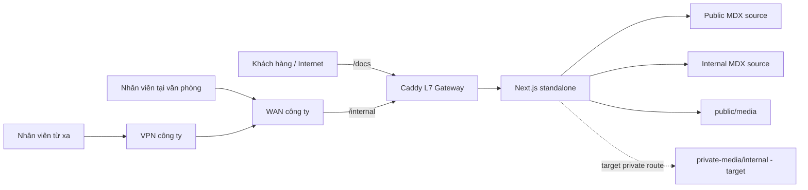
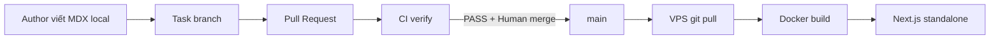

# Kiến trúc ODS Documentation Platform

Tài liệu này mô tả kiến trúc mục tiêu của ODS Documentation Platform và chỉ rõ
những phần đã tồn tại trong runtime. Các quyết định kiến trúc chính thức được lưu
tại [DECISIONS.md](DECISIONS.md).

## 1. Mục tiêu hệ thống

Nền tảng phục vụ hai vùng nội dung có mức độ tin cậy khác nhau:

| Vùng | Đối tượng | Chính sách truy cập |
| --- | --- | --- |
| `/docs/**` | Khách hàng, đối tác, nhân viên | Public Internet |
| `/internal/**` | Nhân viên Support và vận hành | Office WAN hoặc VPN công ty |

`/internal` là wiki read-only. Kiến trúc mục tiêu không có local account,
password, OTP, application session, user database hoặc RBAC.

## 2. Trạng thái hiện tại và kiến trúc mục tiêu

| Thành phần | Current runtime | Target architecture |
| --- | --- | --- |
| Repository | Visibility phải được Human xác minh trên GitHub | Private repository |
| Public docs | Đã hoạt động tại `/docs/**` | Giữ nguyên |
| Internal wiki | `src/proxy.ts` fail-closed; mặc định trả `401` | Caddy chỉ cho office WAN/VPN đi qua, Next.js tiếp tục fail-closed |
| Internal Search | Tách tại `/api/search/internal/**`, mặc định trả `401` | Dùng cùng network gate với `/internal/**` |
| Public media | Git-tracked tại `public/media/**` | Giữ nguyên, chỉ chứa asset được phép public |
| Internal media | Chưa có private delivery route | Git-tracked ngoài `public/`, phục vụ qua `/api/media/internal/**` đã được bảo vệ |

Network gate và private-media route là kiến trúc đã được chấp thuận nhưng **chưa
được triển khai** trong runtime. Cho đến khi có task triển khai và kiểm chứng riêng,
production phải tiếp tục fail-closed.

## 3. System context



VPN client được giả định NAT qua WAN công ty. Vì vậy office user và remote user
sau khi kết nối VPN xuất hiện tại gateway bằng public WAN IP đã được allowlist.
Split-tunnel với IP nhà hoặc mạng di động không thuộc mô hình này.

## 4. Thành phần và trách nhiệm

### Next.js 16 App Router

- Nhận request sau reverse proxy, định tuyến page và Route Handler.
- Render public docs, internal wiki, Search API và metadata.
- Chạy bằng `output: 'standalone'` trong Docker; không dùng static export vì ranh
  giới internal cần server runtime.
- `src/proxy.ts` là lớp bảo vệ fail-closed trong ứng dụng. Hiện tại lớp này chưa
  nhận network assertion từ Caddy và chỉ mở internal trong development bằng
  `ODS_INTERNAL_DEV_OPEN=true`.

### Fumadocs

- Biên dịch và tổ chức PageTree từ nội dung MDX.
- Cung cấp layout tài liệu, sidebar, table of contents và Search index.
- Dùng hai loader độc lập: `source` cho public và `internalSource` cho internal.

### MDX

- Là source of truth cho nội dung tài liệu trong Git.
- `content/docs/**` và `content/internal/**` là hai trust zone; public content
  không được link sang internal content.
- Mọi MDX phải có `title` và `description` trong frontmatter.

### Caddy

- Là reverse proxy và TLS termination point trong target architecture.
- Cho phép `/docs/**` từ Internet.
- Chỉ chuyển `/internal/**`, `/api/search/internal/**` và
  `/api/media/internal/**` khi source IP thuộc office WAN allowlist.
- Giữ `Cache-Control: private, no-store` và không cho client truy cập vòng qua
  Caddy đến port Next.js.

Không đưa cấu hình Caddy giả định vào repository trước khi topology production,
WAN CIDR và cơ chế truyền client IP được kiểm chứng.

### Docker và VPS

- Dockerfile tạo Next.js standalone image trên Node.js 22.
- Container ứng dụng chỉ bind `127.0.0.1:3000`; Caddy là entry point public.
- Nội dung MDX được biên dịch khi build, nên thay đổi bài viết cần rebuild image.
- Public media đang được mount read-only để có thể cập nhật sau `git pull`.

### GitHub private repository và CI

- Code, MDX và media được version control, review qua Pull Request và CI.
- Private repository giới hạn khả năng clone source nhưng không thay thế runtime
  access control hoặc content review.
- Secret, credential, token, private key và dữ liệu cá nhân khách hàng vẫn bị cấm
  commit kể cả khi repository đã private.

## 5. Luồng request

### Public docs

```text
Browser → Caddy → Next.js App Router → Fumadocs public source
        → compiled MDX/React → HTML response
```

Public Search chỉ đọc `source`; sitemap và LLM outputs chỉ xuất public content.

### Internal wiki — current runtime

```text
Browser → Next.js Proxy → không có quyền runtime → 401 + no-store + noindex
```

`ODS_INTERNAL_DEV_OPEN=true` chỉ dành cho development và bị cấm trong production.

### Internal wiki — target architecture

```text
Nhân viên → office network hoặc VPN → WAN công ty
          → Caddy kiểm tra source IP
             ├─ Không thuộc allowlist → 403
             └─ Thuộc allowlist → Next.js Proxy kiểm tra trusted gateway
                                  → internal route/search/media
```

Lớp Next.js không được tin trực tiếp header do Internet client gửi. Task triển khai
sau phải đảm bảo origin chỉ nhận traffic từ Caddy và kiểm chứng cách truyền trusted
gateway assertion trước khi mở production.

## 6. Luồng authoring và deploy



Mọi thay đổi đi qua task spec, branch, PR, CI và báo cáo nghiệm thu. MDX được
compile trong `next build`; chỉ public media đang mount mới có thể cập nhật mà
không rebuild.

## 7. Media boundary

### Public media

- Lưu tại `public/media/**` và được Git theo dõi.
- Có URL public `/media/**`; không đặt screenshot hoặc dữ liệu internal nhạy cảm
  vào đây.

### Internal media — target

- Dự kiến lưu tại `private-media/internal/**` trong private repository.
- Không copy vào `public/` hoặc Next.js static output.
- Chỉ được đọc qua `/api/media/internal/**` sau cùng network authorization với
  `/internal/**`.
- Route phải chống path traversal, giới hạn MIME type và trả
  `Cache-Control: private, no-store`.

Thư mục và route trên chưa tồn tại; một task triển khai riêng phải bổ sung code,
test và migration media trước khi internal MDX tham chiếu đến chúng.

## 8. Cấu trúc dự án

```text
ods-docs/
├── src/
│   ├── app/                         # Next.js App Router
│   │   ├── docs/                    # Public pages
│   │   ├── internal/                # Internal pages
│   │   └── api/search/              # Public và internal Search API
│   ├── components/                  # UI, MDX và flowchart components
│   ├── lib/                         # Sources, layout và shared logic
│   └── proxy.ts                     # Runtime fail-closed boundary
├── content/
│   ├── docs/                        # Public MDX
│   ├── internal/                    # Internal MDX
│   └── _templates/                  # Content templates
├── public/
│   └── media/                       # Chỉ public media
├── private-media/                   # Target, chưa tồn tại
│   └── internal/                    # Internal media ngoài public root
├── harness/                         # Guard, linter và runtime tests
├── tasks/                           # Task specifications
├── .harness/reports/                # Verification reports
├── Dockerfile                       # Next.js standalone image
├── docker-compose.yml               # Application runtime
├── DEPLOY_VPS.md                    # Deployment runbook
├── DECISIONS.md                     # Architecture Decision Records
└── AGENTS.md                        # Invariants và agent workflow
```

## 9. Security invariants và failure modes

- Office WAN phải ổn định. Đổi WAN IP mà chưa cập nhật allowlist sẽ khóa internal.
- Guest Wi-Fi không được NAT qua cùng allowlisted identity nếu guest không được
  phép đọc wiki; cần staff VLAN hoặc network policy tương đương.
- Nếu thêm CDN hoặc Cloudflare, không được tin `X-Forwarded-For` tùy ý. Chỉ trust
  proxy ranges và header đã được gateway chuẩn hóa.
- Port Next.js không được public; nếu không, client có thể đi vòng qua Caddy.
- Network access không bảo vệ thiết bị đã bị chiếm quyền và không cung cấp audit
  theo từng người. Khi cần RBAC/audit, phải mở ADR mới cho identity-aware access.
- Repository private không phải nơi lưu secret. Content review và guard vẫn là
  các lớp kiểm soát bắt buộc.
