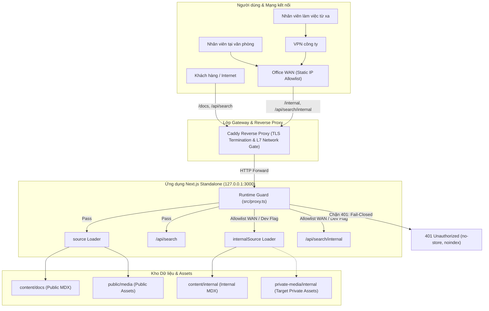
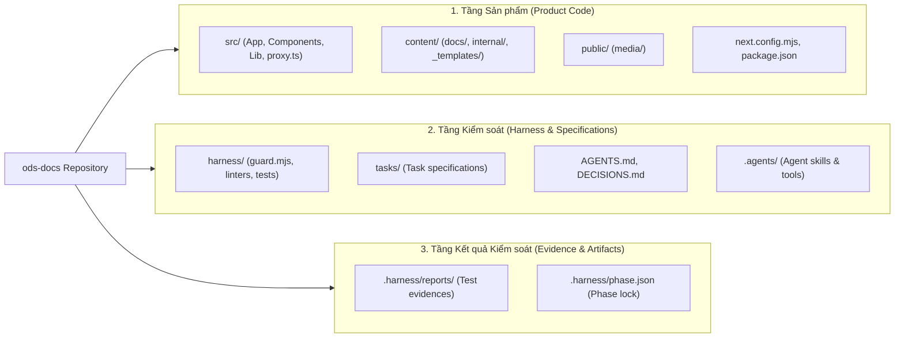

# Kiến trúc ODS Documentation Platform

Tài liệu này mô tả chi tiết kiến trúc hệ thống, ranh giới an toàn (security boundaries), luồng dữ liệu (request flow), công nghệ và các quy tắc vận hành của **ODS Documentation Platform**. Các quyết định kiến trúc chính thức (ADRs) được lưu giữ tại [DECISIONS.md](DECISIONS.md).

---

## 1. Nghiệp vụ & Mục tiêu Hệ thống

Nền tảng phục vụ hai vùng nội dung có mức độ tin cậy và đối tượng hoàn toàn độc lập:

| Vùng | Đường dẫn gốc | Đối tượng sử dụng | Phạm vi nghiệp vụ & Chính sách |
| :--- | :--- | :--- | :--- |
| **Public Docs** | `/docs/**` | Khách hàng, đối tác, nhà phát triển tích hợp | **Public Internet**.<br>- Tài liệu ODS AI Contact Center (Portal, API Reference, Autocall, WebRTC, Webhook).<br>- Tài liệu ODS CloudFile (Lưu trữ doanh nghiệp, phân quyền, ứng dụng).<br>- Trích xuất dữ liệu cho LLM (`llms.txt`, `llms.mdx`). |
| **Internal Wiki** | `/internal/**` | Đội ngũ Kỹ thuật, Vận hành, Hỗ trợ (Support/NOC/SOC) | **Nội bộ (Office WAN hoặc VPN công ty)**.<br>- Support Wiki & Knowledge Base xử lý sự cố viễn thông/mạng.<br>- Quy trình vận hành chuẩn (Operational Processes) có lưu đồ SVG tương tác.<br>- IP hạ tầng và bảng đầu số viễn thông thật (tuân thủ ADR-006). |

`/internal` là wiki read-only. Theo định hướng kiến trúc tại [ADR-007](DECISIONS.md#L112), hệ thống không duy trì local account, password, OTP, application session, user database hoặc RBAC nội bộ nhằm tinh gọn chi phí và loại bỏ bề mặt tấn công tài khoản.

---

## 2. Trạng thái Hiện tại và Kiến trúc Mục tiêu

| Thành phần | Current Runtime | Target Architecture (ADR-007) |
| :--- | :--- | :--- |
| **Repository Visibility** | Visibility phải được Human xác minh trên GitHub | Private repository hoàn toàn |
| **Public Docs** | Hoạt động bình thường tại `/docs/**` | Giữ nguyên |
| **Internal Wiki** | [`src/proxy.ts`](src/proxy.ts) fail-closed; mặc định trả `401 Unauthorized` | Caddy L7 gateway chỉ cho office WAN/VPN đi qua; Next.js giữ lớp kiểm tra fail-closed thứ hai |
| **Internal Search** | Tách tại `/api/search/internal/**`, mặc định trả `401` | Dùng chung network gate với `/internal/**` |
| **Public Media** | Git-tracked tại `public/media/**` | Giữ nguyên, chỉ chứa asset công khai |
| **Internal Media** | Chưa có private delivery route | Git-tracked ngoài `public/` (dự kiến `private-media/internal/**`), phân phối qua `/api/media/internal/**` có bảo vệ |

> [!IMPORTANT]
> Network gate và private-media route là kiến trúc đã được chấp thuận nhưng **chưa được kích hoạt** trong runtime production. Cho đến khi có task triển khai và kiểm chứng riêng, production phải tiếp tục giữ trạng thái **fail-closed**. Tuyệt đối không bật cờ `ODS_INTERNAL_DEV_OPEN=true` trên production.

---

## 3. Sơ đồ Ngữ cảnh Hệ thống (System Context Diagram)



---

## 4. Phân tầng Cấu trúc Kho lưu trữ (ADR-005)

Kho lưu trữ tuân thủ nguyên tắc phân loại rõ ràng theo câu hỏi: *"Nếu xoá file/thư mục này đi thì website có đổi hành vi hoặc ngừng hoạt động không?"*



1. **Tầng Sản phẩm (Product Code)**:
   - Các mã nguồn và nội dung trực tiếp phục vụ người dùng cuối (`src/`, `content/`, `public/`).
   - [`src/proxy.ts`](src/proxy.ts) nằm tại tầng sản phẩm vì nếu thiếu file này, bảo vệ runtime ranh giới sẽ bị vô hiệu hóa.
2. **Tầng Kiểm soát (Harness & Specifications)**:
   - Mã kiểm soát chất lượng, linters, bộ guard an toàn (`harness/`), các bản đặc tả nhiệm vụ (`tasks/`), quy chuẩn agent (`AGENTS.md`) và quyết định kiến trúc (`DECISIONS.md`).
3. **Tầng Kết quả Kiểm soát (Artifacts & Evidence)**:
   - Thư mục `.harness/` chứa dữ liệu máy sinh làm bằng chứng nghiệm thu (`phase.json`, `reports/TASK-XXX-report.md`).

---

## 5. Công nghệ & Trách nhiệm các Thành phần

### Next.js 16 (App Router)
- Cung cấp kiến trúc Server-Side Rendering (SSR) và React Server Components (RSC).
- Đóng gói bằng cờ `output: 'standalone'` để tối ưu hóa kích thước Docker container trên production.
- **Không dùng Static Export (`output: 'export'`)**: Hệ thống bắt buộc phải có server runtime để thực thi chốt chặn bảo vệ `src/proxy.ts`.

### Fumadocs Suite
- **fumadocs-core (16.15.10)**: Xử lý PageTree, nạp cấu trúc cây tài liệu, quản trị phân trang và breadcrumbs.
- **fumadocs-mdx (15.4.0)**: Biên dịch MDX thành các thành phần React hiệu năng cao lúc build.
- **fumadocs-ui (`@fumadocs/base-ui`)**: Cung cấp giao diện documentation tiêu chuẩn (Sidebar, Navbar, TOC, Search Dialog).
- **Phân tách Loader**: Quản lý 2 nguồn loader riêng biệt trong [`src/lib/source.ts`](src/lib/source.ts): `source` cho public và `internalSource` cho internal.

### Tailwind CSS v4 & Lucide Icons
- Ứng dụng Tailwind CSS v4 mới nhất qua `@tailwindcss/postcss`, tối ưu hóa build time và loại bỏ hoàn toàn cấu hình dư thừa.
- Sử dụng biểu tượng kỹ thuật nhất quán từ thư viện `lucide-react`.

### MDX & Custom Interactive Components
- Là source of truth duy nhất cho toàn bộ tài liệu kỹ thuật trong Git.
- Tích hợp các components tương tác chuyên biệt:
  - [`ProcessFlowchart`](src/components/flowchart/process-flowchart.tsx): Lưu đồ quy trình tương tác chuẩn SVG với visual feedback.
  - [`ParamTable`](src/components/api-reference/param-table.tsx): Hiển thị bảng tham số API chuẩn mực, hỗ trợ type badges và requirement labels.
  - API Reference UI: Hỗ trợ kiểm thử endpoint trực tiếp, code snippet đa ngôn ngữ (cURL, JavaScript, Python).

### Caddy Reverse Proxy (L7 Gateway)
- Điểm kết thúc TLS (TLS termination) và reverse proxy chính thức phía trước container Next.js.
- Chuyển tiếp `/docs/**` trực tiếp cho người dùng Internet.
- Chặn truy cập vào `/internal/**`, `/api/search/internal/**` và `/api/media/internal/**` nếu IP nguồn không nằm trong allowlist của văn phòng hoặc VPN công ty.
- Đảm bảo thiết lập header `Cache-Control: private, no-store` cho toàn bộ tài nguyên nội bộ.

### Docker & VPS
- Multi-stage Dockerfile dựa trên nền tảng `node:22-alpine` sinh ra image standalone dung lượng nhỏ, bảo mật cao.
- Container ứng dụng chỉ bind cục bộ tại `127.0.0.1:3000`; chỉ có Caddy được mở cổng ra ngoài.
- Dữ liệu MDX được compile tĩnh lúc build time, do đó khi cập nhật bài viết cần kích hoạt quy trình rebuild image.

---

## 6. Luồng Xử lý Yêu cầu (Request Flow)

### 6.1. Luồng truy cập Public Docs
```text
Trình duyệt người dùng → Caddy Reverse Proxy → Next.js App Router 
  → Fumadocs public source loader (content/docs) 
  → Render React Server Component + MDX 
  → Trả về HTML + Client Hydration
```
- Public Search (`/api/search`) chỉ nạp chỉ mục từ `content/docs`.
- Sitemap và metadata LLM (`/llms.txt`) hoàn toàn không chứa dữ liệu của `/internal`.

### 6.2. Luồng truy cập Internal Wiki (Current Runtime)
```text
Trình duyệt → Caddy → Next.js proxy.ts 
  → Không có header xác thực runtime / Cờ dev tắt 
  → Trả về 401 Unauthorized (kèm Cache-Control: no-store và X-Robots-Tag: noindex, nofollow)
```

### 6.3. Luồng truy cập Internal Wiki (Target Architecture - ADR-007)
```text
Nhân viên (Văn phòng hoặc VPN công ty) 
  → Ra Internet bằng IP WAN công ty đã allowlist 
  → Caddy Gateway kiểm tra IP nguồn:
       ├─ IP không thuộc Allowlist → Trả về 403 Forbidden ngay tại Edge
       └─ IP thuộc Allowlist → Forward sang Next.js kèm Trusted Gateway Assertion
            → Next.js proxy.ts xác thực assertion thành công
            → Nạp internalSource (content/internal)
            → Trả về giao diện Support Wiki & Runbooks
```

---

## 7. Ranh giới Phân phối Media (Media Boundary)

1. **Public Media**:
   - Lưu trữ tại [`public/media/**`](public/media) và được quản lý trực tiếp bằng Git.
   - Có URL công khai `/media/**`. Tuyệt đối không lưu ảnh chụp màn hình chứa dữ liệu nhạy cảm hoặc IP nội bộ tại đây.
2. **Internal Media (Target)**:
   - Lưu trữ tại `private-media/internal/**` (nằm ngoài thư mục `public/`).
   - Phân phối độc quyền qua Route Handler `/api/media/internal/**` được bảo vệ cùng cấp độ với `/internal/**`.
   - Phải có cơ chế chống path traversal, kiểm duyệt MIME type và đính kèm header chống lưu đệm (`Cache-Control: private, no-store`).

---

## 8. Các Invariants An toàn & Kịch bản Thất bại (Failure Modes)

- **Đổi địa chỉ Office WAN**: Nếu địa chỉ IP WAN công ty thay đổi mà chưa kịp cập nhật allowlist trên Caddy, toàn bộ truy cập vào `/internal` sẽ bị chặn (an toàn theo nguyên tắc fail-closed).
- **Mạng Wi-Fi Khách (Guest Wi-Fi)**: Không được định tuyến qua cùng IP WAN allowlist với mạng nội bộ văn phòng; bắt buộc phải phân tách VLAN riêng.
- **Nguy cơ rò rỉ khi đứng sau CDN**: Nếu bổ sung Cloudflare hoặc CDN bên ngoài, không được tin cậy mù quáng các header như `X-Forwarded-For`. Chỉ tin cậy assertion được sinh ra từ Gateway đã xác thực.
- **Port Next.js bị lộ**: Container Next.js tuyệt đối không được bind ra `0.0.0.0` để ngăn chặn client truy cập vòng qua Caddy Gateway.
- **Giới hạn của Network Gate**: Network Gate dựa trên IP/VPN không thể chống lại trường hợp thiết bị của nhân viên đã bị xâm nhập và không cung cấp tính năng ghi vết (audit) theo danh tính từng cá nhân. Nếu trong tương lai cần RBAC hoặc kiểm toán theo người dùng, dự án sẽ mở thêm ADR để triển khai Identity Provider (IdP).
