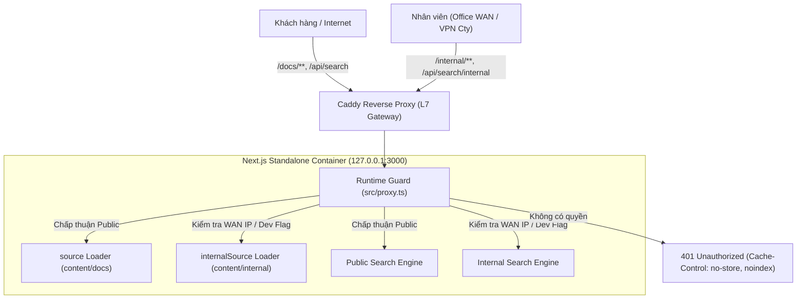
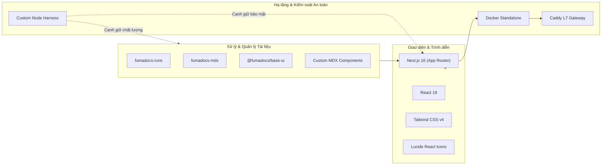

# ODS Documentation Platform (`ods-docs`)

Nền tảng tài liệu kỹ thuật tập trung và Support Wiki nội bộ của ODS, được xây dựng trên nền tảng **Next.js 16 (App Router)**, **Fumadocs Suite** và **MDX**.

---

## 1. Tổng quan Dự án (Project Overview)

### 1.1. Bối cảnh & Bài toán Doanh nghiệp
Trong quá trình vận hành và cung cấp các giải pháp công nghệ đám mây và viễn thông tại ODS, doanh nghiệp đối mặt với hai nhu cầu tài liệu song song:
1. **Khách hàng, đối tác và lập trình viên bên ngoài** cần một cổng thông tin kỹ thuật trực quan, tốc độ tải trang nhanh, chuẩn SEO để tra cứu tài liệu sản phẩm, hướng dẫn tích hợp API/Webhook và tài liệu cho các hệ thống trợ lý AI/LLM.
2. **Đội ngũ kỹ thuật nội bộ (Support, NOC, SOC, DevOps)** cần một trang Support Wiki bảo mật để lưu trữ quy trình vận hành hệ thống, tài liệu xử lý sự cố viễn thông/mạng (Runbooks), sơ đồ quy trình tương tác và các thông số hạ tầng nhạy cảm.

### 1.2. Giải pháp: Cổng Tài liệu Kép (Dual-Zone Platform)
Thay vì duy trì hai nền tảng rời rạc gây phân mảnh nội dung và tốn chi phí hạ tầng, `ods-docs` hợp nhất cả hai nhu cầu vào **một codebase duy nhất** nhưng được phân tách triệt để thành **hai vùng tin cậy (Two Independent Trust Zones)**:

| Phân vùng | Đường dẫn (Route) | Đối tượng phục vụ | Chính sách truy cập & Nội dung nghiệp vụ |
| :--- | :--- | :--- | :--- |
| **Public Docs** | `/docs/**` | Khách hàng, đối tác, lập trình viên | **Công khai trên Internet**.<br>- Hướng dẫn sử dụng ODS Portal.<br>- API Reference (OpenAPI/REST, Autocall, WebRTC, Webhook).<br>- Tài liệu giải pháp lưu trữ ODS CloudFile.<br>- Trích xuất tài liệu cho AI (`llms.txt`, `/docs/*.md`). |
| **Internal Wiki** | `/internal/**` | Nhân viên Kỹ thuật, Vận hành, Hỗ trợ (Support/NOC) | **Nội bộ (Office WAN hoặc VPN công ty)**.<br>- Knowledge Base & Runbooks xử lý sự cố hạ tầng/viễn thông.<br>- Lưu đồ quy trình vận hành tương tác (Data Center, Network, License).<br>- Bảng đầu số nhà mạng và thông số hạ tầng (tuân thủ ADR-006). |

---

## 2. Kiến trúc & Ranh giới Bảo mật (Architecture & Security Boundaries)

Kiến trúc hệ thống được thiết kế theo nguyên tắc **Zero Trust** và **Fail-Closed**, đảm bảo tài liệu nội bộ tuyệt đối không bị rò rỉ ra ngoài internet qua tìm kiếm, sitemap hay AI bot crawler.



### Cơ chế Bảo vệ 3 Tầng (Defense-in-Depth):
1. **Tầng 1: Tách biệt Nguồn dữ liệu (Data Loader Isolation - ADR-001)**:
   - Phân tách hai nguồn nạp nội dung độc lập trong [`src/lib/source.ts`](src/lib/source.ts): `source` (cho `/docs`) và `internalSource` (cho `/internal`).
   - `internalSource` chỉ được import tại 3 vị trí hợp lệ: `lib/source.ts`, `app/internal/**`, và `app/api/search/internal/**`. Công cụ tìm kiếm công khai, sitemap và `llms.txt` tuyệt đối không thể đọc nguồn dữ liệu này.
2. **Tầng 2: Chốt chặn Runtime Fail-Closed ([`src/proxy.ts`](src/proxy.ts))**:
   - Mọi request hướng tới `/internal/**` hoặc `/api/search/internal/**` đều bị chặn mặc định ở trạng thái `401 Unauthorized`.
   - Luôn đính kèm các tiêu đề bảo mật: `Cache-Control: private, no-store, must-revalidate` và `X-Robots-Tag: noindex, nofollow`.
   - Cờ mở dev `ODS_INTERNAL_DEV_OPEN=true` chỉ được dùng local và **bị ném lỗi ngoại lệ (throw Error) ngay lập tức nếu cố tình kích hoạt trên production**.
3. **Tầng 3: Kiểm soát Truy cập cấp Mạng (Target Architecture - ADR-007)**:
   - Sử dụng Caddy làm L7 Network Gate: chỉ cho phép các IP thuộc văn phòng ODS hoặc VPN công ty truy cập vào route `/internal/**`.
   - Mô hình này loại bỏ hoàn toàn nhu cầu về hệ thống tài khoản local, mật khẩu, OTP hay user database, triệt tiêu rủi ro lộ credential.

---

## 3. Tech Stack & Vai trò Chi tiết của Từng Công nghệ

Dưới đây là chi tiết các công nghệ được lựa chọn và vai trò kỹ thuật cụ thể của từng thành phần trong nền tảng:



| Công nghệ | Phiên bản | Vai trò & Lý do lựa chọn trong dự án |
| :--- | :--- | :--- |
| **Next.js (App Router)** | `16.4.3` | **Xương sống của ứng dụng web**.<br>- Cung cấp Server-Side Rendering (SSR) và React Server Components (RSC) giúp tải trang tức thì và tối ưu SEO cho tài liệu công khai.<br>- Cung cấp môi trường Server Runtime để thực thi chốt chặn bảo vệ `src/proxy.ts` (điều mà static site export không làm được).<br>- Hỗ trợ đóng gói dạng `standalone` tối ưu kích thước container. |
| **React** | `^19.2.8` | **Nền tảng giao diện người dùng**.<br>- Xây dựng các UI component phản hồi cao.<br>- Hỗ trợ render linh hoạt các component tương tác trực tiếp bên trong nội dung văn bản Markdown. |
| **Fumadocs Suite** | Core `16.15.10`<br>MDX `15.4.0`<br>UI `@fumadocs/base-ui` | **Engine tài liệu chuyên dụng**.<br>- **fumadocs-core**: Tự động phân tích cây tài liệu (PageTree), xử lý breadcrumbs, TOC (Table of Contents) và chuyển đổi Markdown.<br>- **fumadocs-mdx**: Biên dịch MDX hiệu năng cao lúc build, nạp metadata và xử lý thẻ frontmatter.<br>- **@fumadocs/base-ui**: Cung cấp bộ khung giao diện tài liệu tiêu chuẩn (Sidebar co giãn, hộp thoại tìm kiếm nhanh, chuyển đổi Dark/Light mode). |
| **MDX (Markdown + JSX)** | `@types/mdx` | **Ngôn ngữ định dạng nội dung**.<br>- Đóng vai trò là source-of-truth cho tài liệu, dễ viết, dễ version control qua Git.<br>- Cho phép nhúng trực tiếp các React component nâng cao vào giữa bài viết (lưu đồ, bảng tham số, nút test API). |
| **Tailwind CSS v4** | `^4.3.3` | **Hệ thống tạo kiểu (Styling)**.<br>- Tích hợp thông qua `@tailwindcss/postcss` thế hệ mới, biên dịch CSS siêu tốc và loại bỏ file cấu hình cồng kềnh.<br>- Chuẩn hóa hệ màu, khoảng cách và typography theo phong cách documentation cao cấp. |
| **Lucide React** | `^1.43.0` | **Thư viện biểu tượng kỹ thuật**.<br>- Cung cấp icon đồng bộ, nhẹ và hiện đại cho menu điều hướng, các danh mục dịch vụ và trạng thái quy trình. |
| **Docker (Standalone)** | Node `22-alpine` | **Đóng gói và triển khai**.<br>- Dockerfile đa tầng (Multi-stage) chỉ copy các file output standalone thực sự cần thiết, giảm dung lượng image từ >1GB xuống chỉ còn ~150MB, nâng cao tính bảo mật khi chạy trên VPS. |
| **Caddy Server** | L7 Gateway | **Reverse Proxy & Cổng bảo vệ mạng**.<br>- Xử lý cấp phát chứng chỉ SSL tự động (TLS termination).<br>- Đóng vai trò L7 Network Gate: lọc IP văn phòng/VPN trước khi request chạm vào container ứng dụng và áp đặt chính sách cấm lưu cache đối với nội dung nội bộ. |
| **Node.js Test Harness** | Tự phát triển (`harness/`) | **Hệ thống kiểm soát chất lượng & an toàn tự động**.<br>- Thay thế việc kiểm tra thủ công bằng các script máy học chạy cơ học: quét secret, phát hiện link hỏng, kiểm tra ranh giới dữ liệu và ép buộc phạm vi sửa đổi task. |

---

## 4. Cấu trúc Thư mục Dự án (Project Directory Structure)

Hệ thống thư mục được phân tách rõ ràng theo mô hình **3 Tầng Kiến trúc (ADR-005)**:

```text
ods-docs/
├── 📁 src/                           # [TẦNG 1: SẢN PHẨM] Mã nguồn ứng dụng Next.js
│   ├── app/                         # App Router: /docs, /internal, /api/search
│   ├── components/                  # React Components: giao diện, lưu đồ SVG, bảng API
│   ├── lib/                         # Loaders (source.ts), cấu hình sản phẩm, shared utils
│   └── proxy.ts                     # Runtime fail-closed security boundary
├── 📁 content/                       # [TẦNG 1: SẢN PHẨM] Toàn bộ nội dung tài liệu (MDX)
│   ├── docs/                        # Tài liệu công khai (AI Contact Center, CloudFile)
│   ├── internal/                    # Support Wiki nội bộ (Knowledge Base, Runbooks, Processes)
│   └── _templates/                  # Mẫu chuẩn hóa để tạo bài viết mới nhanh chóng
├── 📁 public/                        # [TẦNG 1: SẢN PHẨM] Tài nguyên tĩnh công khai (/media/**)
├── 📁 harness/                       # [TẦNG 2: KIỂM SOÁT] Bộ công cụ kiểm thử & linters tự động
│   ├── guard.mjs                    # Quét rò rỉ secret, ranh giới trust zone, frontmatter
│   ├── linters/                     # Bộ kiểm tra liên kết gãy, kiểm tra phạm vi task, biến môi trường
│   └── tests/                       # Các bài test hồi quy (routes, UI, search, flowchart)
├── 📁 tasks/                         # [TẦNG 2: KIỂM SOÁT] Danh sách đặc tả nhiệm vụ (TASK-XXX.md)
├── 📁 .harness/                      # [TẦNG 3: BẰNG CHỨNG] Kết quả kiểm soát do máy sinh ra
│   ├── phase.json                   # Cơ chế khóa giai đoạn phát triển (Phase Lock)
│   └── reports/                     # Báo cáo nghiệm thu kết quả kiểm thử thực tế
├── 📄 AGENTS.md                      # Quy tắc bắt buộc cho AI coding agents & Developers
├── 📄 ARCHITECTURE.md                # Tài liệu chi tiết kiến trúc, request flow & bảo mật
├── 📄 DECISIONS.md                   # Hồ sơ quyết định kiến trúc chính thức (ADR-001 -> ADR-007)
├── 📄 DEPLOY_VPS.md                  # Hướng dẫn build Docker và triển khai lên máy chủ VPS
├── 📄 Dockerfile                     # Multi-stage Docker build cho Next.js standalone
├── 📄 docker-compose.yml             # Khởi chạy dịch vụ container trên VPS
└── 📄 source.config.ts               # Cấu hình Fumadocs content collections
```

---

## 5. Hướng dẫn Khởi chạy & Phát triển Cục bộ (Getting Started)

### 5.1. Yêu cầu Tiên quyết (Prerequisites)
- **Node.js**: Phiên bản `>=22.23.4 <23` (bắt buộc để đảm bảo tính tương thích với Next.js standalone và harness test scripts).
- **npm**: Đi kèm với Node.js.

### 5.2. Cài đặt & Khởi chạy

```bash
# 1. Clone repository về máy
git clone <repository-url>
cd ods-docs

# 2. Cài đặt các thư viện phụ thuộc
npm install

# 3. Khởi chạy môi trường phát triển
npm run dev
```
Truy cập giao diện tại: [http://localhost:3000](http://localhost:3000).

### 5.3. Mở truy cập Wiki Nội bộ trên Local (`/internal`)
Theo mặc định, truy cập vào `/internal/**` sẽ trả về `401 Unauthorized` (do cơ chế Fail-Closed). Để mở phân vùng này khi làm việc cục bộ:
1. Tạo tệp `.env.local` tại thư mục gốc (tệp này đã nằm trong `.gitignore`):
   ```env
   ODS_INTERNAL_DEV_OPEN=true
   ```
2. Khởi động lại `npm run dev`. Bây giờ bạn có thể truy cập [http://localhost:3000/internal](http://localhost:3000/internal).

> [!CAUTION]
> Biến `ODS_INTERNAL_DEV_OPEN=true` tuyệt đối không được đưa vào môi trường Production. Ứng dụng sẽ throw error và ngừng chạy ngay lập tức nếu phát hiện cờ này trong môi trường production.

---

## 6. Hướng dẫn Tác nghiệp Thường nhật (Daily Workflows)

### 6.1. Cách Viết một Bài Tài liệu Mới
1. **Xác định phân vùng**:
   - Tài liệu cho khách hàng $\rightarrow$ Thêm file `.mdx` vào `content/docs/<san-pham>/...`
   - Tài liệu hỗ trợ nội bộ $\rightarrow$ Thêm file `.mdx` vào `content/internal/<chuyen-muc>/...`
2. **Khai báo Frontmatter bắt buộc**: Mọi file MDX bắt buộc phải có `title` và `description`:
   ```mdx
   ---
   title: Hướng dẫn Cấu hình Định tuyến Cuộc gọi
   description: Các bước thiết lập kịch bản định tuyến cho ODS AI Contact Center.
   ---

   Nội dung bài viết bắt đầu từ đây...
   ```
3. **Cập nhật Cây Thư mục (`meta.json`)**: Mở file `meta.json` trong cùng thư mục để sắp xếp thứ tự hiển thị của bài viết trên Sidebar:
   ```json
   {
     "title": "Tên Chuyên Mục",
     "pages": [
       "index",
       "bai-viet-moi"
     ]
   }
   ```

### 6.2. Sử dụng các Component Tương tác có sẵn
Trong nội dung bài viết MDX, bạn có thể gọi trực tiếp các component độc quyền của dự án:
* **Lưu đồ Quy trình Tương tác SVG**:
  ```mdx
  <ProcessFlowchart id="call-routing-process" />
  ```
* **Bảng Tham số API chuẩn mực**:
  ```mdx
  <ParamTable params={[
    { name: "campaign_id", type: "string", required: true, description: "ID chiến dịch gọi" },
    { name: "max_retries", type: "number", required: false, description: "Số lần gọi lại tối đa" }
  ]} />
  ```

---

## 7. Bảng Lệnh Tham chiếu (Commands Cheat Sheet)

| Lệnh npm | Vai trò & Khi nào cần sử dụng? |
| :--- | :--- |
| `npm run dev` | Khởi chạy server development tại cổng 3000 với tính năng Hot Reload. |
| `npm run build` | Biên dịch toàn bộ tài liệu MDX và tạo bản build Next.js production `standalone`. |
| `npm run types:check` | Tự động sinh route types cho Next.js và kiểm tra kiểu dữ liệu TypeScript nghiêm ngặt. |
| `npm run check:env` | Kiểm tra tính an toàn của các tệp biến môi trường, đảm bảo không bị commit nhầm. |
| `npm run check:links` | Quét toàn bộ liên kết nội bộ trong bài viết MDX, ngăn chặn link gãy và link trái phép public $\rightarrow$ internal. |
| `npm run check:scope` | Kiểm tra danh sách tệp thay đổi so với phạm vi khai báo trong task file. |
| `npm run guard` | **Người gác cổng an toàn**: Quét mã tìm secret, kiểm tra ranh giới dữ liệu và cấu trúc frontmatter. |
| `npm run verify:code` | Chạy nhanh chuỗi kiểm tra tĩnh (`types:check` + `check:env` + `check:links` + `guard`). |
| `npm run verify:task` | **Lệnh nghiệm thu tổng lực**: Chạy toàn bộ static checks, build production và chạy toàn bộ regression test suite trước khi nộp task/mở PR. |

---

## 8. 5 Quy tắc An toàn Bất di bất dịch (Engineering Invariants)

Bất kỳ thành viên nào tham gia phát triển dự án đều phải tuân thủ nghiêm ngặt các quy tắc sau:

1. **Tuyệt đối không đổi `output: 'standalone'` thành `output: 'export'`**: Nền tảng bắt buộc phải có server runtime để thực thi ranh giới bảo mật `src/proxy.ts`.
2. **Không commit Secret và Dữ liệu cá nhân**: Mật khẩu, private token, API key và PII khách hàng tuyệt đối không được đưa vào Git. IP hạ tầng và bảng đầu số viễn thông thật chỉ được ghi trong `content/internal/**/knowledge-base/**` (theo ADR-006).
3. **Không để `internalSource` rò rỉ**: Cấm import ngoài các route nội bộ; không đưa nội dung nội bộ vào search công khai hay `llms.txt`.
4. **Không sửa test để pass giả tạo**: Khi kiểm thử báo FAIL, bắt buộc phải sửa code/nội dung cho đúng đặc tả. Cấm nới lỏng ngưỡng kiểm tra hoặc sửa script harness khi chưa có sự chấp thuận của Human.
5. **Mọi thay đổi phải đi qua Task Spec & Branch riêng**:
   - Bắt đầu bằng bản đặc tả nhiệm vụ tại `tasks/TASK-XXX-ten-task.md`.
   - Tạo nhánh làm việc: `task/TASK-XXX-ten-task`.
   - Tạo báo cáo nghiệm thu `.harness/reports/TASK-XXX-report.md` với kết quả chạy thật của `npm run verify:task`.
   - Chỉ chuyển trạng thái task thành `status: done` sau khi CI trên Pull Request đã chuyển sang màu xanh.

---

## 9. Tài liệu Chuyên sâu Liên quan

- [ARCHITECTURE.md](ARCHITECTURE.md) — Kiến trúc hệ thống, sơ đồ phân luồng dữ liệu và chi tiết ranh giới an toàn.
- [DECISIONS.md](DECISIONS.md) — Toàn bộ hồ sơ quyết định kiến trúc chính thức (ADRs từ ADR-001 đến ADR-007).
- [DEPLOY_VPS.md](DEPLOY_VPS.md) — Quy trình đóng gói Docker và triển khai lên máy chủ VPS.
- [AGENTS.md](AGENTS.md) — Quy chuẩn hành vi và quy tắc bắt buộc cho AI coding agent.
- [content/README.md](content/README.md) — Chuẩn mực và quy tắc biên soạn nội dung MDX.
- [harness/README.md](harness/README.md) — Hướng dẫn hạ tầng kiểm soát và bộ công cụ kiểm thử.
- [tasks/README.md](tasks/README.md) — Quy trình quản lý vòng đời task và scope enforcement.
